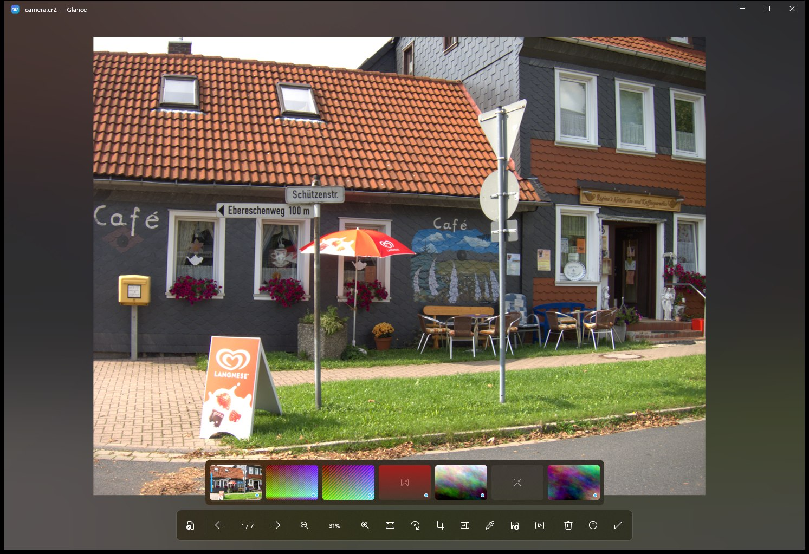

<p align="center">
  
</p>

<h1 align="center">Glance</h1>

<p align="center">
  <b>Install once, open everything — instantly.</b><br>
  A fast, free and open-source image viewer for Windows 10 and 11.
</p>

<p align="center">
  <a href="../../releases/latest"><b>⬇ Download the latest release</b></a>
  &nbsp;·&nbsp;
  <a href="README.tr.md">Türkçe</a>
</p>



## Why Glance?

- **Opens what Windows can't.** HEIC from your iPhone, AVIF, WebP, JPEG XL, camera RAW, Photoshop files, HDR/EXR — no Microsoft Store codec extensions, nothing else to install.
- **Fast.** Images are decoded at screen size on a background thread, rendered on the GPU, and the next 16 photos in the direction you're browsing are prepared ahead of time. A small dot in the filmstrip shows which ones will open instantly.
- **Explorer thumbnails** for the formats Windows normally shows as a blank icon.
- **Private.** No telemetry, no account, no network access. Your photos never leave your PC.
- **Free and open source** under the GPL-3.0.

## Features

| | |
|---|---|
| **Viewing** | Zoom around the cursor, pan with momentum, fit / 100 % toggle, rotate, full screen, touch and touchpad gestures |
| **Browsing** | Folder navigation in File Explorer order, filmstrip with thumbnails, drag & drop, recent files, single window |
| **Looks** | Mica / Acrylic backdrop, ambient light that picks up the photo's colours, slide transitions, light & dark theme |
| **Slideshow** | Full screen with a gentle Ken Burns drift (**S**) |
| **Info panel** | Live RGB histogram, camera, lens, exposure (f-number · shutter · ISO · focal length), date taken, GPS location (**I**) |
| **Editing** | Lossless JPEG rotation, crop (**C**), save as JPEG / PNG / WebP / AVIF / JPEG XL / TIFF / BMP with quality and resize (**Ctrl+S**). Originals are never overwritten silently: in-place saves move the original to the Recycle Bin first |
| **Compare** | Two photos side by side with synchronised zoom and pan (**K**) |
| **Loupe** | 8× magnifier with colour picker; click copies `#RRGGBB` (**L**) |
| **Animation** | GIF and animated WebP with play / pause and frame stepping |
| **Colour** | Embedded ICC profiles converted to sRGB (iPhone Display P3 looks right), HDR tone-mapped |
| **Safety net** | Delete goes to the Recycle Bin with a 5-second undo |
| **Languages** | English and Turkish |

## Supported formats

| Kind | Formats |
|---|---|
| Everyday | JPEG, PNG, GIF, BMP, TIFF, ICO |
| Modern | **HEIC / HEIF**, **AVIF**, **WebP**, **JPEG XL**, JPEG XR, JPEG 2000, QOI |
| Camera RAW | CR2, CR3, NEF, NRW, ARW, DNG, RAF, ORF, RW2, PEF, SRW, 3FR, IIQ, X3F and more — the camera's preview appears instantly, full RAW development when you zoom in |
| Pro & creative | PSD / PSB, TGA, EXR, Radiance HDR, SVG, DDS, PCX, PNM |

Glance never *writes* HEIC (patent-encumbered); it reads it.

## Keyboard shortcuts

Press **?** in the app to see them all.

| Keys | Action |
|---|---|
| ← → · PgUp PgDn | Previous / next image |
| Home · End | First / last image in the folder |
| Mouse wheel · + − | Zoom |
| 0 · 1 · double-click | Fit to window · actual size · toggle |
| R · Shift+R | Rotate right / left |
| F · F11 · Esc | Full screen / leave |
| S | Slideshow |
| B | Ambient light on / off |
| I | Info panel |
| C · Ctrl+S | Crop · Save as |
| K · L | Compare · Loupe and colour picker |
| Space · , · . | Play / pause animation · previous / next frame |
| Del · Ctrl+Z | Move to Recycle Bin · undo |
| Ctrl+C · Ctrl+Shift+C | Copy image · copy file path |
| Ctrl+O · Ctrl+E | Open · show in File Explorer |

## Install

Download from the [latest release](../../releases/latest):

- **`Glance-x.y.z-x64-setup.exe`** — recommended. Installs for your user only (no administrator rights), adds Glance to *Open with* and to *Settings › Apps › Default apps*, and enables Explorer thumbnails. Uninstall from *Settings › Apps* like any other app.
- **`Glance-x.y.z-x64-portable.zip`** — unzip anywhere and run `Glance.exe`. The first-run dialog offers the same integration; `Glance.exe --unregister` removes it.
- **ARM64** builds (Surface Pro X, Snapdragon laptops) are next to them.

> The installer isn't code-signed yet, so Windows SmartScreen may warn on first launch. Choose **More info → Run anyway**. Every release is built from this repository by GitHub Actions — you can check the build log for each download.

**Requirements:** Windows 10 version 1809 or later, or Windows 11. Nothing else — the .NET runtime and every decoder are included.

### Make Glance your default viewer

Windows lets only you choose default apps. On first launch Glance offers to open *Settings › Default apps* directly on its own page (Windows 11); pick Glance there and set it as default.

## Privacy

Glance makes no network connections. There is no telemetry, no update check, no account. The only time a browser opens is when you click "Open in map" in the info panel. Error logs stay on your PC in `%LOCALAPPDATA%\Glance\logs`.

## Build from source

Requirements: Windows, the [.NET 10 SDK](https://dotnet.microsoft.com/download), and for the Explorer thumbnail DLL the Visual Studio C++ build tools (NativeAOT linker).

```bash
dotnet build src/Glance.App
```

```bash
dotnet test --solution Glance.slnx
```

Release build exactly as GitHub Actions does it (trimmed, self-contained, with the thumbnail handler):

```bash
dotnet publish src/Glance.App -c Release -r win-x64 -o out/Glance
```

Pushing a tag such as `v0.2.0` makes `.github/workflows/release.yml` build the x64 and ARM64 installers and portable zips and attach them to a GitHub Release.

## How it's built

| Project | What it does |
|---|---|
| `src/Glance.App` | WinUI 3 app: Win2D canvas, view model, single-instance activation, registration |
| `src/Glance.Core` | No UI: folder navigation and file watching, memory-bounded LRU cache, prefetch order, settings |
| `src/Glance.Imaging` | Decoders: WIC (through generated COM), Magick.NET for everything else, RAW preview scanner, metadata, editing |
| `src/Glance.Thumbnails` | Explorer thumbnail handler compiled with NativeAOT (no .NET runtime loaded into Explorer's host) |
| `tests/` | xUnit v3: decoders, all 8 EXIF orientations, colour management, formats, editing, registration |
| `docs/adr` | Architecture decision records — the "why" behind each choice |

## Contributing

Bug reports and pull requests are welcome. Translations live in `src/Glance.App/Strings/<language>/Resources.resw`; copy `en-US` to add a language.

## License

Glance is free software under the **GNU General Public License v3.0 or later** — see [LICENSE](LICENSE).
The Glance name and logo are not covered by that license.
Bundled third-party components and their licenses: [THIRD_PARTY_NOTICES.md](THIRD_PARTY_NOTICES.md).
The sample photo in the screenshot is from [raw.pixls.us](https://raw.pixls.us) (CC0).
